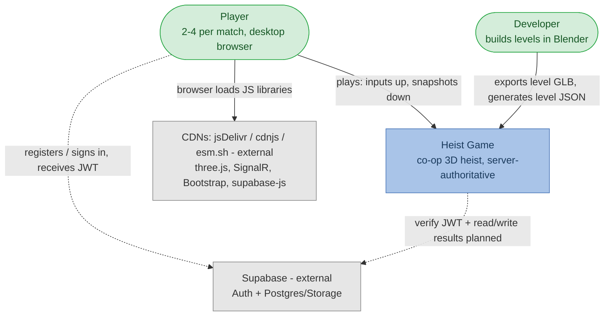
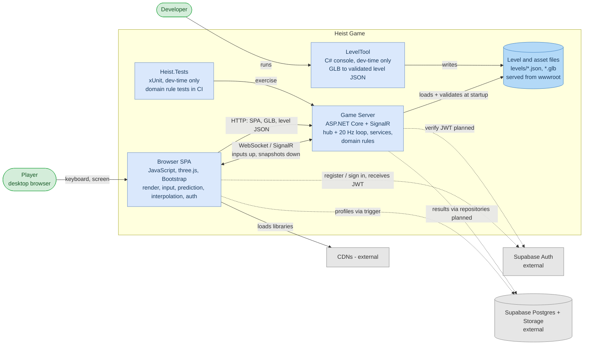
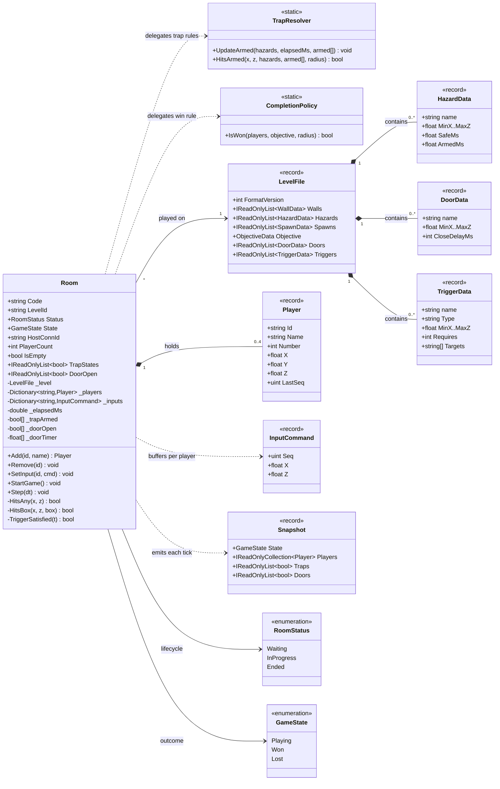
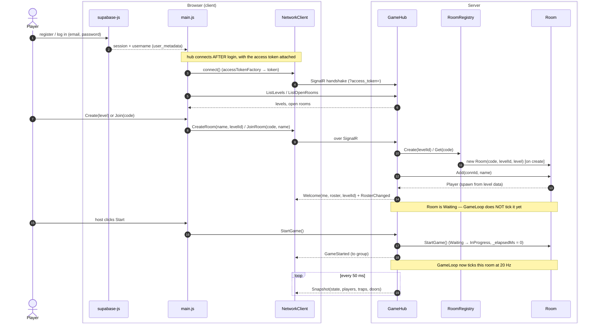

# [Heist]

<!-- CI badge: after Session 4, replace ORG/REPO and the workflow filename, then uncomment:

-->

**Student:** [Enzo Swayne] · **Course:** CEN 5064 Software Design, Fall 2026 · **Partner:** [@JosephGabrie]

> I am including a status key for this document: ** ✅ = built and running, ◻ = planned functionality and not yet implemented.
> I made the architecture the *planned* layered design, but had to delineate what was completed and what was aspired.

## Project (approval paragraph — write this by Sun Aug 30)

I propose developing a small 3D multiplayer heist game that runs in a web browser. This application allows a group to connect to a shared game session,
interact with a 3D environment, coordinate, complete objectives, and escape from the place. The technology used will be Three.js/Javascript on the
client, using ASP.NET Core/C# for the server, SignalR for real-time communication, and Supabase/PostgreSQL for persistence and authentication. The 
main focus is software architecture and design patterns, not gameplay or art. The architecture will be layered with a separation between presentation,
application, domain, and data/infrastructure. The design principles will be SOLID, dependency inversion, and the use of design patterns such as SignalR behind a 
transport/session interface. The game will be small enough to finish, with a focus on use cases such as joining sessions, synched movements, interaction, and
objective completion. Testing will be demonstrable with local tests and multiplayer through at least two browser tabs or simulated clients. My personal 
motivations include a desire to strengthen my Three.js and 3D web dev skills, working with a familiar tech stack, and creating a fun multiplayer experience.

## How to run
### PART 1
## Prerequisites
- .NET 8 SDK (ASP.NET Core 8). Verify: `dotnet --version` -> 8.x.

## Run the program
```
cd <unzipped-folder>/Heist
dotnet run --launch-profile https
```

Open https://localhost:7159 and accept the dev-cert warning
(or run `dotnet dev-certs https --trust` once to avoid it).

### Play a 2-player match (two browser windows)
**Window 1*
1. Go to `https://localhost:7159/` - you land on the **login** page.
2. Click **Create account**, register with (email, username, 16+ char pass with uppes/lowes/numerals/symbols), then **log in** with that email + pass.
3. You're in the **Lobby**. Pick a level and click **Create Game** -> you're the host in the **Waiting Room**.

**Window 2*
1. Go to `https://localhost:7159/` , register and log in with a **different** account.
2. In the Lobby, **Join** the open game from the list -> **Waiting Room**.

**STart & play**
- In Window 1 (host), click **Start** -> both windows load the level.
- Move with **WASD**; **mouse** lets you look around (click the game to capture the pointer, **Esc** to release).
- Reach the **yellow objective** to win; avoid **armed traps** (they flash red). in `longlevel`, the door gate is an additional puzzle for you to figure out with the buttons.
- **Win** or **Lose** -> click button to return to Lobby.

> One note: Supabase email confirmation is **off** for local testing, so new accounts work immediately. On real deployment it would be turned on.

### Running Tests
```
dotnet test Heist/Heist.sln
```
Runs the `Heist.Tests` domain rule tests (Won / Lost). The CI runs the same on every push/PR to `main`.

---------------------------------------------------------------------------------------------------------

## Architecture

### Tier breakdown (Session 2 studio updated 10/11)


| Tier | Responsibilities in THIS system | Classes / Modules |
|------|--------------------------------|-------------------|
| **Presentation** | ✅ Browser renders the 3D scene + GLB art<br>✅ Browser turns WASD into a camera-relative movement intent<br>✅ Browser predicts the local player, interpolates remotes<br>✅ Browser: login/lobby/waiting/game views, win/lose banners, fetches level JSON<br>✅ Browser: Supabase register + login (account identity)<br>✅ Server `GameHub` receives calls/inputs, pushes snapshots to the room group<br>✅ Server `GameLoop` drives the 20 Hz tick<br>◻ Server middleware validates the Supabase JWT *(client already attaches the token; server-side validation deferred)* | ✅ `SceneManager.js`<br>✅ `InputController.js`<br>✅ `NetworkClient.js`<br>✅ `main.js`<br>✅ `auth/supabaseClient.js`, `auth/register.js`<br>✅ `GameHub.cs`<br>✅ `GameLoop.cs`<br>✅ `Program.cs` (composition root) |
| **Service** | ✅ Create / join / start / leave rooms; route inputs<br>✅ Tick every in-progress room, return snapshots (no transport knowledge)<br>✅ Keep the directory of live rooms *(teardown race fix deferred)*<br>✅ Load + validate levels; list the playable ones<br>✅ Provision a profile on first sign-up *(via DB trigger, not a service yet)*<br>◻ Record finished matches; read history and best times | ✅ `GameHub` methods *(proto-matchmaking; a dedicated `MatchSessionService` is ◻)*<br>✅ `RoomRegistry`<br>✅ `LevelLoader` + `LevelCatalog`<br>◻ `AuthService`, `MatchResultService`, `StatisticsService` |
| **Domain** | ✅ `Room.Step`: freeze → trap clock → trigger/door eval → movement → hazard check → win check<br>✅ Movement: circle-vs-AABB collide-and-slide *(inline; see SOLID notes)*<br>✅ Touching an armed trap → **Lost**; reaching the objective → **Won**<br>✅ Trigger/door evaluation (plate → door, AND-gated)<br>✅ Entities + enums; no framework code<br>◻ Repository contracts | ✅ `Room`, `LevelFile`, `Player`<br>✅ `TrapResolver`, `CompletionPolicy`<br>✅ `RoomStatus`, `GameState`, `Snapshot`, `InputCommand`<br>✅ `HazardData`, `DoorData`, `TriggerData`, `SpawnData`, `ObjectiveData`<br>◻ `MovementRules` *(deliberately inline)*, `TriggerSystem` *(deliberately inline)*<br>◻ `ILevelRepo`, `IMatchResultRepo`, `IPlayerProfileRepo` |
| **Data** | ✅ Level files (`levels/*.json`; Supabase Storage later)<br>✅ `profiles` table (username, wins, losses) — written on sign-up via trigger<br>◻ Match results table (level, players, outcome, time) + history/best-time queries<br>◻ Server-side Supabase access behind repositories | ✅ `LevelLoader` *(the JSON "repo" for now)*<br>✅ Supabase `public.profiles` (+ `handle_new_user` trigger, `username_available` RPC)<br>◻ `MatchResultRepo`, `PlayerProfileRepo` |

> **Dev Note:** What is working today meets all the requirements for completion for this project. The **Browser** talks to Supabase directly (register/login) and the `profiles` row is created by a Postgre trigger. The **server** doesn't read/write the JWT verification and score writes are the next step in this plan. Passwords live only in Supabase `auth.users` using bcrypt, never in my table.

### C4 — Context & Container 

*Added dashed edges for planned context.*

 

### UML — Class & Sequence (current deployment)


#### Sequence Diagram: register/login -> join -> play




> Note: the client does attach the Supabase JWT to the SignalR handshake but the server doesn't yet verify it. SO the identity is cosmetic at the moment.


----------------------------------------------------------------------------------------

## SOLID Principles & Design Patterns 

### SOLID - where did i apply them
 
- **Single Responsibility (SRP).** `Room` owns per-room *state* and orchestrates the tick; the *rules* live in their own classes: `TrapResolver` (trap arming + hazard-loss) and `CompletionPolicy` (win check), both pure static functions. Level loading is split: `LevelLoader` loads + validates files, `LevelCatalog` holds and serves them. *(These were extracted from `Room` after a peer-review SRP note — `Room` went from six inline jobs to orchestrating two rule classes.)*
- **Open/Closed (OCP).** Levels are **data**: a new level (geometry, hazards, spawns, objective, doors, triggers) is a new JSON file — no code change. New gameplay follows the same shape — "new fields in the snapshot, new cases in `Room.Step`" — rather than editing existing rules.
- **Liskov (LSP).** The planned repository interfaces (`ILevelRepo`, `IMatchResultRepo`, `IPlayerProfileRepo`) let a JSON-backed or Supabase-backed implementation substitute without the Domain noticing. *(Interfaces owned in Domain; ◻ implementations.)*
- **Interface Segregation (ISP).** `NetworkClient` exposes a thin, intention-named wrapper over the SignalR hub (`createRoom`, `join`, `onSnapshot`…) rather than leaking the transport. Repository interfaces are kept small and purpose-specific rather than one god-repo.
- **Dependency Inversion (DIP).** Dependencies point *inward*: the Data tier will implement interfaces **owned by Domain**, never the reverse. `Program.cs` is the composition root wiring `RoomRegistry`, `LevelCatalog`, and `GameLoop` via the DI container; the game loop depends on the registry abstraction, not concrete construction.
### Design patterns — applied
 
- **Registry** — `RoomRegistry` is the single directory of live rooms (create / get / track / teardown).
- **Composition Root + Dependency Injection** — `Program.cs` (server) and `main.js` (client) assemble the object graph in one place.
- **Observer / publish–subscribe** — SignalR hub events (`Welcome`, `RosterChanged`, `Snapshot`, …); clients subscribe, the server broadcasts to a room group.
- **State machine** — two independent axes: `RoomStatus` (Waiting → InProgress → Ended) governs *lifecycle*; `GameState` (Playing / Won / Lost) governs *outcome*.
- **Repository** *(◻ planned)* — Domain-owned interfaces, Data-tier implementations over Supabase.
- **Server-authoritative prediction/reconciliation** — the netcode pattern: client predicts locally, server is the source of truth, client replays unacknowledged inputs.
### Deliberately NOT used (and why)
 
- **GoF Singleton pattern → chose DI singleton *lifetime* instead.** `RoomRegistry` / `LevelCatalog` are single instances, but the container owns that decision (`AddSingleton`), not a private static `Instance`. The classes keep public constructors, stay unit-testable, and carry no global mutable state. The GoF Singleton would have made them global and hard to test.
- **`MovementRules` as a separate class → kept inline in `Room.Step`.** The movement math must stay **byte-identical** with the client's `shared/movement.js`. A C# class boundary doesn't remove the real coupling (which is cross-*language*, not cross-class) — it adds ceremony around code whose true mirror lives in JavaScript. So movement stays in `Room.Step` on purpose, unlike the trap/win rules.
- **`TriggerSystem` as a separate class → kept inline.** Only one trigger type (`plate`) exists today. Extracting a general trigger framework now would be premature generalization (YAGNI); it gets its own class when a *second* trigger type justifies the abstraction.
- **A physics engine for the character → plain AABB collide-and-slide.** Deterministic simple math keeps the client prediction and server simulation identical. A physics engine (BepuPhysics) is reserved for *dynamic trap objects only* (future), never the character.
- **An ORM / EF for levels → flat JSON files.** Levels are tool-generated data, version-controlled and diffable; an ORM would add a layer with no benefit at this scale.
- **Verified identity on the hub (JWT validation) → deferred (prototype scope).** The client attaches the Supabase JWT, but the server does not yet verify it, so the in-game identity is cosmetic and scores can't be securely attributed. This is an accepted prototype limitation, not an oversight — it becomes required before real score-tracking.
---

## Architecture Decision Records

Decisions live in [`docs/adr/`](docs/adr/). Start with ADR-001 in Session 4.

| # | Decision | Status |
|---|----------|--------|
| [001](docs/adr/adr-001.md) | [What I am building and why] | [proposed] |

## Weekly log (optional but recommended)

A one-line note per week keeps your commit story readable:

- Week 1 (Aug 24): repo created, three ideas drafted
- Week 2 (Aug 31): ...


# Working on Test Ping
Will Create Test ping 
